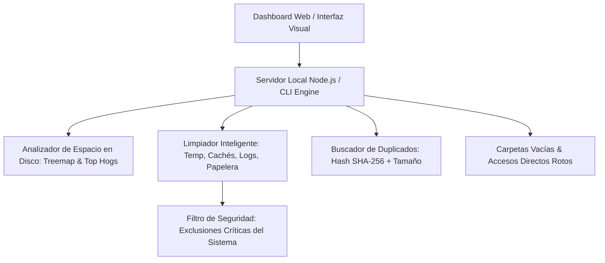

# Informe Técnico: Ingeniería Inversa de Glary Utilities & Arquitectura de Limpieza de Disco

Este documento detalla el análisis de la arquitectura interna de **Glary Utilities 6**, cómo gestiona y limpia el espacio en disco en Windows, y cómo utilizaremos estos principios para construir una versión personal moderna y segura.

---

## 1. Análisis con REA (`morluto/rea`) y Binarios de Glary

[REA](https://github.com/morluto/rea) (*Reverse Engineer Anything*) es un toolkit diseñado para descompilar e inspeccionar binarios nativos, aplicaciones JavaScript/Electron y ensamblados. 

Al inspeccionar los binarios de Glary Utilities ubicados en `C:\Program Files (x86)\Glary Utilities`, determinamos lo siguiente:

* **Arquitectura de compilación:** Aplicación nativa Win32 C++/MFC compilada con Microsoft Visual Studio 2008 / VC90 (`mfc90u.dll`, `atl90.dll`, `msvcr90.dll`).
* **Compresión interna:** Emplea **ZLIB / Minizip** de Gilles Vollant (`zlib1.dll`) con cabeceras personalizadas (`0x47 0x55` = ASCII "GU" para datos cifrados/comprimidos).
* **Almacenamiento y persistencia:** Utiliza archivos INI, XML y bases de datos SQLite (`sqlite3.dll`, `uninstall.db`).

---

## 2. Componentes Clave de Glary Utilities

Glary Utilities divide la administración de espacio en varios ejecutables y DLLs modulares:

| Componente | Archivo Principal | Función Real |
| :--- | :--- | :--- |
| **Disk Cleaner** | `DiskCleaner.exe` / `DiskCleaner.dll` | Escaneo y purga de archivos temporales, logs antiguos, volcados de memoria y cachés. |
| **Disk Analysis** | `DiskAnalysis.exe` / `ScanFile.dll` | Análisis de árbol de directorios, cálculo de tamaños acumulados y clasificación por tipos. |
| **Duplicate Finder** | `dupefinder.exe` | Localización de archivos duplicados por tamaño y checksum. |
| **Empty Folder Finder** | `EmptyFolderFinder.exe` | Detección de carpetas vacías con lista de exclusión de seguridad del sistema. |
| **Indexador Rápido** | `MemfilesService.exe` / `Memfiles.dll` | Servicio de indexación en memoria (`Memfiles_C.dat`, `Memfiles_D.dat`) para consultas de archivos ultra rápidas. |
| **Shortcut Fixer** | `ShortcutFixer.exe` | Detección y eliminación de accesos directos huérfanos (`.lnk` rotos). |

---

## 3. Motor de Reglas y Patrones Extraídos

A través de la extracción de los archivos de configuración (`Category.ini`, `junkInfo.ini`, `empty.dat`), obtuvimos las reglas exactas que utiliza Glary:

### A. Patrones de Archivos Basura (`junkInfo.ini`)
```ini
*.tmp   = Archivos temporales de aplicaciones
*.temp  = Archivos temporales generales
*.chk   = Fragmentos recuperados por Scandisk / Chkdsk
*.old   = Archivos de copia de seguridad obsoletos
*.bak   = Respaldos viejos
*.dmp   = Volcados de memoria de caídas de sistema (Memory Dumps)
*.gid   = Índices de ayuda antiguos
*.~*    = Temporales de editores de texto / Office
~*.*    = Bloqueos temporales de documentos
*.$$$   = Archivos temporales de instalación
```

### B. Categorización de Archivos (`Category.ini`)
* **Imágenes:** `*.JPG`, `*.PNG`, `*.GIF`, `*.PSD`, `*.RAW`, `*.SVG`, `*.ICO`, etc.
* **Audio:** `*.MP3`, `*.WAV`, `*.WMA`, `*.M4A`, `*.FLAC`, `*.AAC`, etc.
* **Video:** `*.MP4`, `*.MKV`, `*.AVI`, `*.MOV`, `*.WMV`, `*.FLV`, etc.
* **Comprimidos / Archivos:** `*.ZIP`, `*.RAR`, `*.7Z`, `*.TAR`, `*.GZ`, `*.ISO`.
* **Documentos:** `*.DOC`, `*.DOCX`, `*.PDF`, `*.XLS`, `*.XLSX`, `*.PPT`, `*.PPTX`, `*.TXT`.

### C. Directorios Críticos Limpiados (Datos reales del sistema)
Del registro de ejecución de Glary en tu equipo (`GULog`), se identificaron las ubicaciones que más espacio consumen:
1. `%USERPROFILE%\AppData\Local\Temp` (Cachés de VSCode, Docker, compiladores Node.js, instaladores).
2. `C:\Windows\Temp` (Instaladores del sistema y servicios).
3. `C:\$Recycle.Bin` (Papelera de reciclaje).
4. `%LOCALAPPDATA%\Google\Chrome\User Data\Default\Service Worker\CacheStorage` y `GPUCache` (Caché de navegadores).
5. `%LOCALAPPDATA%\Microsoft\Windows\Explorer\thumbcache_*.db` (Caché de miniaturas).
6. `C:\Windows\Minidump` y `C:\ProgramData\Microsoft\Windows\WER` (Reportes de errores de Windows).

### D. Lista de Exclusiones de Seguridad Críticas (`empty.dat`)
Glary **nunca** toca ciertas rutas aunque parezcan vacías o temporales:
* `*\printhood\*`
* `*\startup\*`
* `*\common files\*`
* `*\resources\themes\*`
* `?:\system volume information\*`
* `*\microsoft\money\*\webcache\*`

---

## 4. Plan para Nuestra Versión Personal

Para crear tu propio administrador de espacio personal inspirado en Glary Utilities pero mucho más ligero, moderno y sin publicidad:



### Características Principales:
1. **Analizador Visual de Disco:** Gráficos de uso por unidad (C:, D:), desglose por categoría y lista interactiva de los archivos más pesados.
2. **Limpieza Inteligente con Modo Simulación (Dry-Run):** Permite ver cuánto espacio se liberará antes de borrar un solo archivo.
3. **Detector de Duplicados Rápido:** Algoritmo en 2 fases (filtro por tamaño primero, y luego hash parcial/total).
4. **Seguridad Total:** Protección contra eliminación de carpetas protegidas del sistema operativo.
